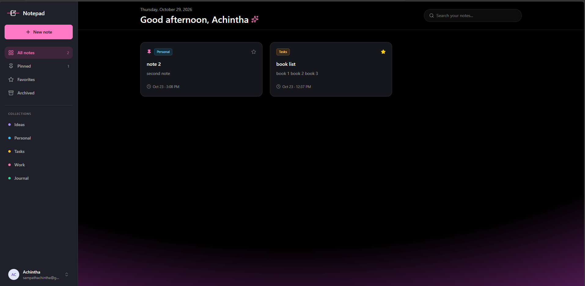
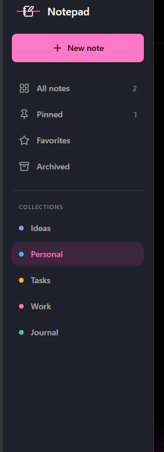
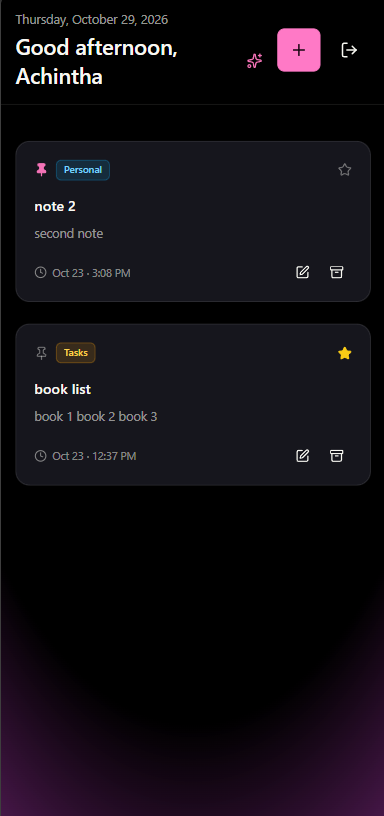

# Notepad: Notes App

A full-stack note-taking app built with the MERN stack. Create an account, organize your notes into color-coded collections, pin and favorite the important ones, and archive what you no longer need. Every user only ever sees their own notes.

## Live Demo

🔗 https://notes-app-ly7k.onrender.com/

> The app is hosted on Render's free tier, so the first request after a quiet period can take up to a minute while the server wakes up. Register your own account to try it.

## Screenshots

| Home | Collections and favorites | Mobile |
| --- | --- | --- |
| |  |  |

| Edit note | Login |
| --- | --- |
| ![Edit note] (image-3.png)| ![Login] (image-4.png) |

## About this project

The basic notes app (creating, reading, updating and deleting notes, plus API rate limiting) started as a follow-along tutorial. I then extended it into a multi-user app with authentication, a redesigned interface and several features of my own, listed below.

## Features

**From the tutorial**

- Create, edit and delete notes
- Rate limiting on the API
- Toast notifications for user feedback

**What I added**

- **Accounts and authentication:** register and log in with JWT, with passwords hashed using bcrypt
- **Private notes:** every note belongs to a user, and every query is scoped to the logged-in user, including get, update, pin and delete by id
- **Pin and unpin** notes
- **Favorites** with a star toggle
- **Collections** (Ideas, Personal, Tasks, Work, Journal) with color-coded tags that match the sidebar
- **Archive instead of delete:** archived notes can be restored, and are only deleted permanently from the Archived view
- **Search** across note titles and content
- **Sidebar views** (All notes, Pinned, Favorites, Archived, and each collection) driven by URL query parameters, so the back button and page refresh keep your place
- **Relative dates** such as "Today · 9:42 AM" and "Yesterday · 4:18 PM"
- **Redesigned UI:** dark theme, card layout with hover states, profile menu with logout
- **Responsive layout:** sidebar on desktop, compact top bar on small screens

## Tech Stack

| Layer | Technologies |
| --- | --- |
| Frontend | React (Vite), React Router, Tailwind CSS, DaisyUI, Axios, React Hot Toast, Lucide icons |
| Backend | Node.js, Express.js, JSON Web Tokens, bcrypt |
| Database | MongoDB, Mongoose |
| Deployment | Render (one service serves both the API and the built React app) |

## How it works

- **Authentication:** logging in returns a signed JWT. The frontend stores it and an Axios request interceptor adds it to every request as an `Authorization: Bearer` header. An Express middleware verifies it and attaches the user to the request.
- **Ownership:** each note has a `user` field. Controllers read the user id from the verified token, never from the request body, and look notes up by both the note id and the user id, so one user can't read or change another user's notes.
- **Views and filters:** the sidebar links change the URL (`/?view=pinned`, `/?collection=Work`). The home page reads those query parameters and filters the loaded notes on the client.
- **Archive:** archiving sets an `isArchived` flag. Archived notes are hidden from every view except Archived.
- **Protected routes:** a route guard sends logged-out visitors to the login page, and the session is re-checked with `/api/auth/me` when the app loads.

## Getting Started

### Prerequisites

- Node.js and npm installed
- A MongoDB Atlas account

### Installation

1. Clone the repository

   ```bash
   git clone https://github.com/Achch4/Notes_App.git
   cd Notes_App
   ```

2. Install backend dependencies

   ```bash
   cd backend
   npm install
   ```

3. Create a `.env` file inside the `backend` folder

   ```
   PORT=5000
   MONGODB_URI=your_mongodb_connection_string
   JWT_SECRET=a_long_random_string
   ```

   You can generate a secret with:

   ```bash
   node -e "console.log(require('crypto').randomBytes(48).toString('hex'))"
   ```

4. Start the backend server

   ```bash
   npm run dev
   ```

5. Open a new terminal and install the frontend dependencies

   ```bash
   cd frontend
   npm install
   ```

6. Start the frontend development server

   ```bash
   npm run dev
   ```

7. Open http://localhost:5173, register an account, and start writing notes.

## Project Structure

```
Notes_App/
├── backend/
│   └── src/
│       ├── config/        database connection
│       ├── controllers/   auth and notes logic
│       ├── middleware/    JWT check, rate limiter
│       ├── model/         User and Note schemas
│       └── routes/        /api/auth and /api/notes
└── frontend/
    └── src/
        ├── components/    SideBar, Navbar, NoteCard, ProtectedRoute
        ├── context/       AuthContext
        ├── libs/          axios client, collections, date helpers
        └── pages/         Home, Create, NoteDetail, Login, Register
```

## Roadmap

- [ ] Navigation for views and collections on small screens
- [ ] Server-side search and pagination
- [ ] Refresh tokens or httpOnly cookies instead of a token in localStorage
- [ ] Custom collections created by the user

## License

This project is for educational and portfolio purposes.
